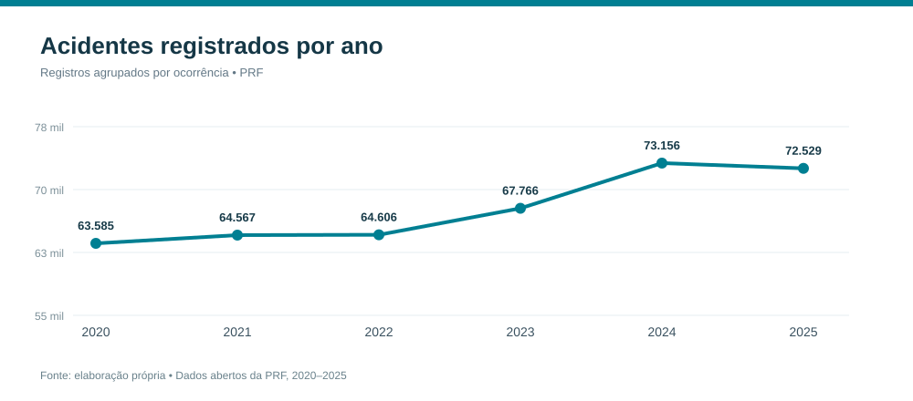
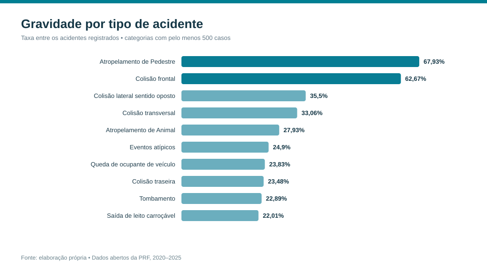
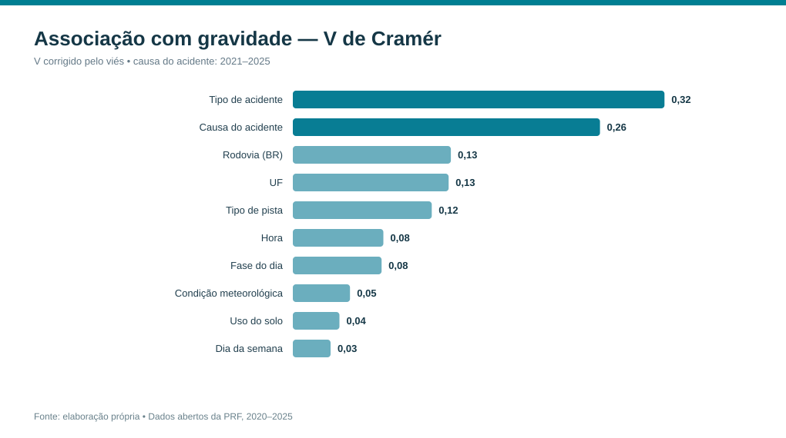
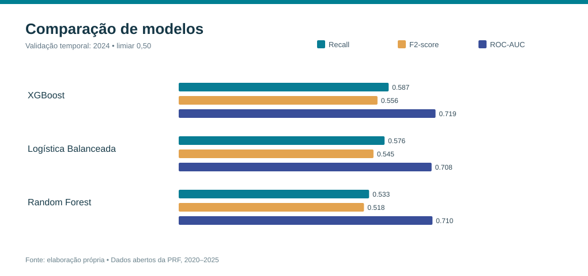
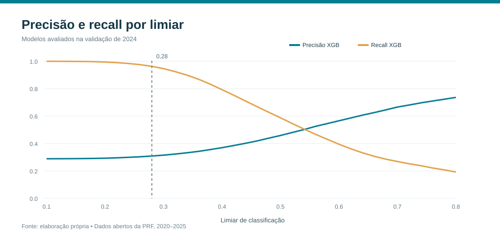
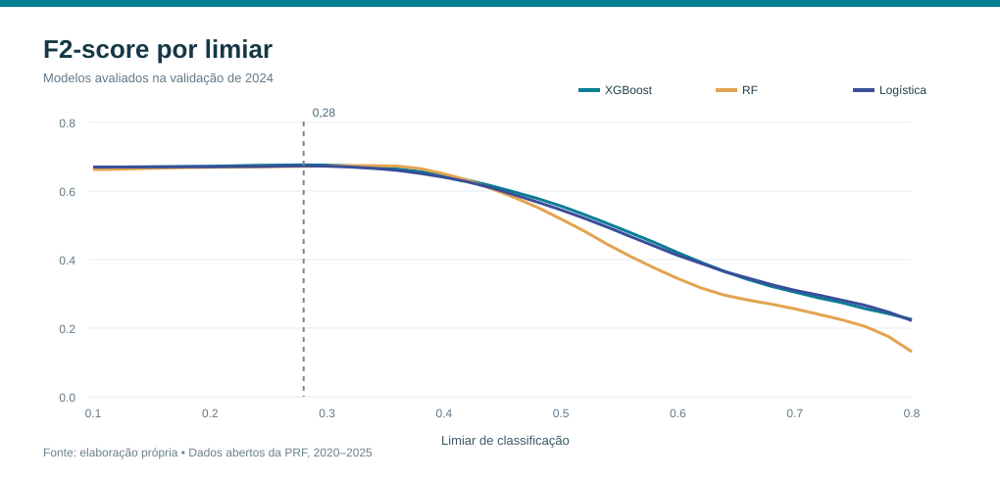
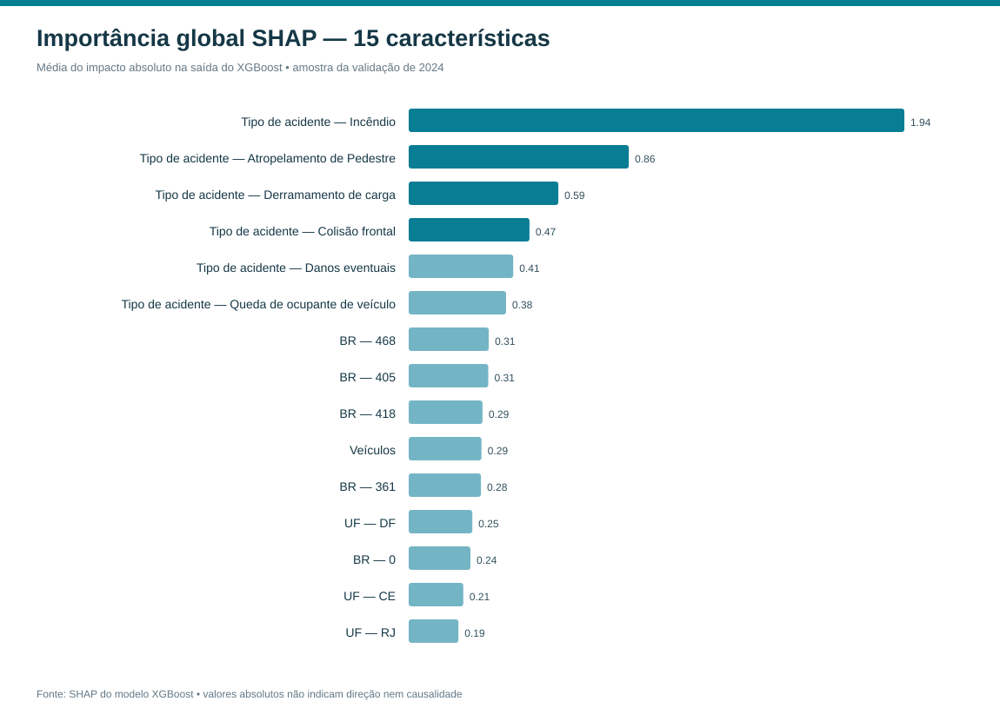

# Acidentes em rodovias federais brasileiras — análise de dados e Machine Learning

Projeto técnico de **Denis Dorneles** (Engenharia da Computação) com dados abertos da **Polícia Rodoviária Federal (PRF)**, entre **2020 e 2025**.

Este repositório contém **somente código, notebooks, visualizações e resultados tabulares reproduzíveis**. Não inclui artigo, apresentação, roteiros ou documentos acadêmicos.

## Objetivo

Investigar quais características dos acidentes **já registrados** estão associadas à presença de vítimas graves ou fatais e comparar modelos para classificar essas ocorrências. **Não é um sistema de previsão de acidentes futuros nem uma análise causal.**

## Dados

Fonte oficial: [Dados Abertos da PRF](https://www.gov.br/prf/pt-br/acesso-a-informacao/dados-abertos/dados-abertos-da-prf), arquivos **agrupados por ocorrência**. Os ZIPs e Parquets não são versionados no Git; o primeiro notebook os baixa e prepara localmente.

- **406.209** acidentes (2020–2025)
- **31** atributos originais; **55** após o tratamento
- **114.309** acidentes graves/fatais (**28,14%**)

O alvo `acidente_grave` vale **1** quando `mortos > 0` ou `feridos_graves > 0`; caso contrário, vale **0**. As colunas que revelam as consequências do acidente não integram os preditores.

## Fluxo da análise

```text
PRF (2020–2025) → Coleta → Auditoria → Base Silver
                                    ↓
                       EDA → Qui-quadrado e V de Cramér
                                    ↓
                       Modelos A/B → LR / RF / XGBoost
                                    ↓
                          Limiar F2 (2024) → SHAP
                                    ↓
                             Teste final (2025)
```

| Etapa | Período |
|---|---|
| Treinamento inicial | 2020–2023 |
| Validação e seleção | 2024 |
| Treino final | 2020–2024 |
| Teste final independente | 2025 |

## Figuras

### Evolução de acidentes (2020–2025)



### Tipos de acidente com maior proporção grave



### Associação estatística — V de Cramér



### Comparação dos algoritmos (validação 2024)



### Precisão e recall por limiar



### F2 por limiar



### Interpretabilidade SHAP — importância global



## Resultado final do XGBoost — teste de 2025

Threshold selecionado na validação: **0,28**, priorizando o **F2-score**.

| Indicador | Resultado |
|---|---:|
| Recall da classe grave | **96,78%** |
| Precisão | 30,76% |
| Acurácia | 37,54% |
| F2-score | 0,677 |
| ROC-AUC | 0,714 |
| Average Precision (AP, apresentada no estudo como PR-AUC) | 0,529 |

Matriz de confusão:

| Classe real | Previsto não grave | Previsto grave |
|---|---:|---:|
| Não grave | 7.391 | 44.645 |
| Grave | 660 | 19.833 |

**Limitação:** o elevado recall acompanha muitos falsos positivos. Esse modelo é uma demonstração analítica e não está pronto para decisões automáticas em segurança viária.

## Estrutura

```text
.
├── README.md
├── requirements.txt
├── .gitignore
├── notebooks/
│   ├── 01_coleta_integracao.ipynb
│   ├── 02_auditoria_qualidade.ipynb
│   ├── 03_tratamento_base.ipynb
│   ├── 04_analise_exploratoria.ipynb
│   ├── 05_associacoes_estatisticas.ipynb
│   ├── 06_experimentos_machine_learning.ipynb
│   ├── 07_comparacao_modelos.ipynb
│   ├── 08_interpretabilidade_xgboost.ipynb
│   ├── 09_interpretabilidade_shap.ipynb
│   └── 10_teste_final_2025.ipynb
├── figures/          # Gráficos SVG versionados
├── outputs/          # CSVs de resultados
└── data/
    ├── raw/          # Não versionado
    └── processed/    # Não versionado
```

## Como executar

No terminal, após instalar Python 3.10+:

```bash
git clone https://github.com/denisddv/tcc-acidentes-prf-machine-learning.git
cd tcc-acidentes-prf-machine-learning
python -m pip install -r requirements.txt
jupyter notebook
```

No Google Colab:

```python
!git clone https://github.com/denisddv/tcc-acidentes-prf-machine-learning.git
%cd /content/tcc-acidentes-prf-machine-learning
!pip install -r requirements.txt -q
```

Abra e execute os notebooks **na ordem numérica**, mantendo como pasta de trabalho a raiz do repositório. Os notebooks 06–09 usam somente o treino/validação; o notebook 10 abre 2025 para o teste final.

## Reprodutibilidade e ressalvas

- Os CSVs em `outputs/` são **resultados históricos do experimento**. Reexecuções podem variar com mudanças de versões das bibliotecas, dos arquivos disponibilizados pela PRF e das condições de execução.
- A variável `causa_acidente` é analisada separadamente em **2021–2025** devido à alteração da taxonomia.
- Os indicadores por UF/BR descrevem a **gravidade condicional aos acidentes registrados**, não risco por quilômetro rodado.
- Importância de atributo e valores SHAP não demonstram causalidade.
- A reprodução integral exige verificar as versões e os arquivos baixados; as figuras SVG foram reconstruídas a partir dos CSVs de resultados.

**Autor:** Denis Dorneles · Engenharia da Computação

## Fonte dos dados

[Polícia Rodoviária Federal — Dados Abertos](https://www.gov.br/prf/pt-br/acesso-a-informacao/dados-abertos/dados-abertos-da-prf)
